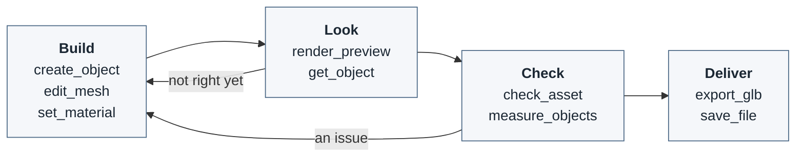
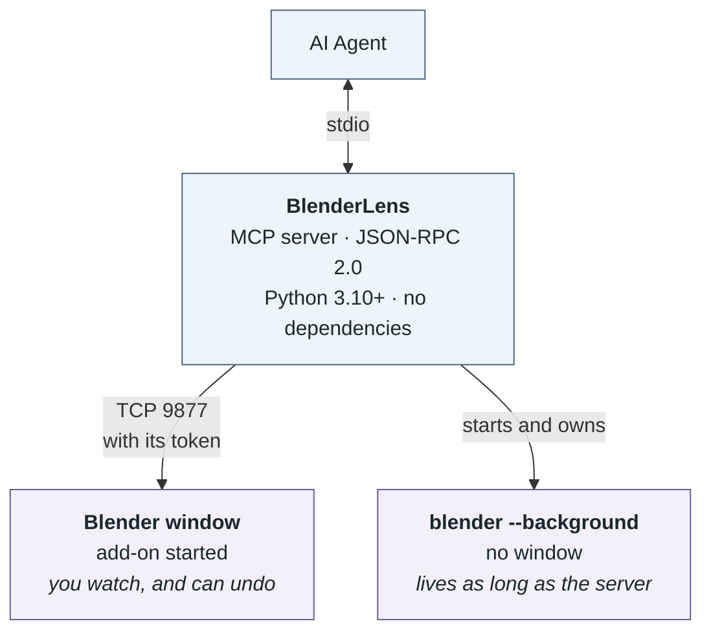

# BlenderLens: game assets built, checked and exported by Blender itself

[](https://github.com/pzalutski-pixel/blenderlens-mcp/releases)
[](https://www.npmjs.com/package/blenderlens-mcp)
[](https://pypi.org/project/blenderlens-mcp/)
[](https://github.com/pzalutski-pixel/blenderlens-mcp/blob/main/LICENSE)

An MCP server that lets an AI agent work in **Blender itself**: build and shape objects with Blender's own
operations, look at a rendered preview, check the asset against a triangle budget and your project's rules, and
export a `.glb` that is read back from disk and judged for Godot or three.js.

<p align="center">
  
</p>
<p align="center"><i>A short animated scene that an AI agent made in Blender through BlenderLens, shown at double
speed.</i></p>

## Why

An agent that models through Blender Python is working blind. It cannot see what it built, cannot tell whether
the exported file holds what it meant, and learns about a part that did not export, or an import hint it never
intended, only when the game shows it.

BlenderLens never judges an asset from what the agent intended. It asks Blender, and the written file. Measured on
Blender 5.0.1, on a scene with a 0.5 m crate, a lid named `Lid_col` parented to it, and a metaball:

| Approach | Result |
|----------|--------|
| `bpy.ops.export_scene.gltf(...)` from a script | `{'FINISHED'}` and a 3,244-byte file. Nothing more |
| `check_asset` | `passed: false`: the metaball is an error (`surface_not_exported`), and the crate's origin sits in its middle, not on its base (`origin_not_at_base`) |
| `export_glb` with `target: "godot"` | The file read back from disk: one root, `Crate`, 24 triangles. Warnings that the metaball was written with no mesh, that Godot gives `Lid_col` a StaticBody3D because of its name, and that the root stands 0.25 m off the origin |

That principle, *ask Blender and the file, never assume*, runs through every tool. The building tools return what
Blender now holds. `render_preview` renders the scene with Blender. `check_asset` reads the mesh as the exporter
will write it. `export_glb` reads back the file it wrote.

## Requirements

| | Needed for |
|---|---|
| **Blender 4.2 LTS or later** (tested on 4.2 and 5.0) | everything; found through `BLENDER_BIN`, `PATH`, or the usual install folders |
| **Python 3.10+**, or **Node.js 18+** for `npx` | running this server, which has no dependencies |
| The BlenderLens add-on in Blender | only to watch the agent work in a Blender window |

Blender 4.2 is the floor because it is the oldest LTS release with the extension system the add-on installs through.
An older Blender is refused with a clear message. No GPU is needed: previews and bakes render with Cycles on the CPU.

## Install

**npx** (recommended). The package bundles the server, and needs Python 3.10 or later on `PATH`.

```json
{
  "mcpServers": {
    "blenderlens": {
      "command": "npx",
      "args": ["-y", "blenderlens-mcp"],
      "env": { "BLENDER_BIN": "C:\\Program Files\\Blender Foundation\\Blender 5.0\\blender.exe" }
    }
  }
}
```

**pip**

```bash
pip install blenderlens-mcp
```

```json
{
  "mcpServers": {
    "blenderlens": { "command": "blenderlens-mcp", "env": { "BLENDER_BIN": "/path/to/blender" } }
  }
}
```

In Claude Code this goes in a project's `.mcp.json`. That is all a headless pipeline needs: the first call that
needs Blender starts `blender --background`, and the server keeps it until the server exits.

### Watching it work in Blender

To have the agent work in a Blender window you watch, and can undo, install the add-on:

```bash
blenderlens-mcp install-addon       # or: npx -y blenderlens-mcp install-addon; --blender PATH picks the Blender
```

Then, in the 3D viewport, press **N**, open the **BlenderLens** tab and press **Start**. The add-on listens on this
machine only, and serves only a server that holds its token, which it writes to a file the server reads.

## The loop

The tools are designed around one cycle. Read it once and the rest of this document is a reference.



1. **Build.** `create_object` makes a part with its size built into the mesh, `edit_mesh` shapes it,
   `set_material` colours it, and `join_objects` and `set_parent` assemble parts. An existing build script runs
   as it is with `run_script`.
2. **Look.** `render_preview` renders the part, or a sheet of several angles, as a PNG to look at. `get_object`
   gives exact sizes and counts.
3. **Check.** `check_asset` finds broken geometry, unapplied scale, a misplaced origin, UV and texture problems,
   parts passing through each other, and anything over budget or against your rules, each with the faces
   concerned. `measure_objects` says what touches what.
4. **Deliver.** `export_glb` writes the file for your target engine, reads it back and warns. `save_file` keeps
   the `.blend`.

Three conventions apply throughout:

- **Units are metres, rotations degrees, and Z is up.** A model's front faces -Y; `export_glb` converts to glTF's
  Y-up, where the front faces +Z.
- **Face indices are what `get_mesh` lists**, and change after any edit that adds or removes faces. `edit_mesh`
  returns the faces it made.
- **A refusal changes nothing.** It is a structured error with `error`, `exit`, `kind` and `hint`. The kinds, with
  their exit codes: `blender_error` 1, `not_found` 2, `bad_argument` 3, `python_error` 4, `unsaved_changes` 5,
  `blender_missing` 6, `not_connected` 7, `connection_lost` 8, `start_failed` 9, `version_mismatch` 10,
  `token_mismatch` 11, `busy` 12, `not_allowed` 13, `internal_error` 70, `deadline` 124.

## Tools

### Session

| Tool | Description |
|------|-------------|
| `get_status` | Which Blender the server is using and what it is busy with, without starting one. Start here if anything behaves oddly. |
| `open_session` | Connect to the Blender window running the add-on, or start a background Blender, optionally opening a `.blend`. |
| `close_session` | Disconnect. A background Blender exits; a window stays open. Refused while there are unsaved changes, unless `discard`. |

### Inspecting

| Tool | Description |
|------|-------------|
| `get_scene` | Every object with its type, parent, location, dimensions, counts, materials and modifiers. |
| `get_object` | One object in full: transform, bounds, counts before and after modifiers, and every modifier setting. |
| `get_mesh` | An object's faces with index, centre, normal, the side they face and material: the indices other tools take. |
| `list_materials` | Every material's values and the objects using it. |

### Building

| Tool | Description |
|------|-------------|
| `create_object` | A primitive, a tube along a path, a lathed profile, 3D text, or an empty. Sizes go into the mesh, so scale stays 1. |
| `create_mesh` | A mesh from vertices and faces, for shapes no primitive gives. |
| `edit_mesh` | Extrude, inset, bevel, bisect, solidify, subdivide and more, on faces picked by index or by the way they face. |
| `add_modifier` | Add any Blender modifier, with settings by Blender's own names. |
| `set_modifier` | Change a modifier's settings, place in the stack, or visibility. |
| `apply_modifier` | Make a modifier's result part of the mesh. |
| `remove_modifier` | Remove a modifier without applying it. |
| `set_material` | Create or update a PBR material, with emission, transparency, culling and images, on an object or picked faces. |
| `set_vertex_color` | Paint faces into a color attribute, wired so the file carries it as `COLOR_0`. |
| `unwrap_uv` | Unwrap into a UV map, and report islands, overlaps and texel density. |
| `join_objects` | Join meshes into one part, each piece keeping its materials. |
| `animate_object` | Key transforms and shape keys into a named clip, exported as one glTF animation. Warns when Godot will loop it by name. |
| `create_collision` | A box, convex or decimated collision proxy, named so Godot makes a static body of it. |
| `bake_texture` | Bake colour, ambient occlusion, normals or lighting into a PNG with Cycles, and wire it into the material. |

### Arranging

| Tool | Description |
|------|-------------|
| `set_transform` | Location, rotation, scale or dimensions. With `drop`, the object falls until it rests on what is below. |
| `apply_transform` | Apply rotation and scale to the mesh, or move the origin, for example to the bottom centre. |
| `set_parent` | Parent or unparent, keeping the world position. |
| `set_collection` | Move objects into a collection. |
| `set_object` | Rename, hide, or set custom properties, which export as glTF extras. |
| `duplicate_object` | Copy an object with its modifiers, materials and children. |
| `delete_object` | Delete objects. |

### Checking

| Tool | Description |
|------|-------------|
| `check_asset` | Check the asset as it will export, against a triangle `budget` and your project's `rules`. Returns `passed` and each issue with its faces. Changes nothing. |
| `measure_objects` | Distances between parts, whether they touch, overlap or sit inside each other, or a ray cast into the scene. |

### Seeing

| Tool | Description |
|------|-------------|
| `render_preview` | A framed PNG from any angle, or a sheet of several views; clay, wireframe and per-part colour styles; cutaways and fixed game cameras. The scene is left as it was. |

### Files

| Tool | Description |
|------|-------------|
| `export_glb` | Write a `.glb` for `godot`, `threejs` or `generic`, read it back from disk, and warn about what the target will make of it. |
| `export_file` | Write FBX, OBJ, STL, PLY or USD, and read it back. |
| `import_file` | Import a glTF, OBJ, FBX, STL or PLY file, or append objects from a `.blend`. |
| `save_file` | Save the `.blend`, or a checkpoint copy. |
| `open_file` | Open a `.blend`. |
| `create_file` | Start a new, empty file. |

### Python and undo

| Tool | Description |
|------|-------------|
| `run_python` | Python inside Blender, for anything no tool covers. |
| `run_script` | Run a build script file, with its helper modules importable. |
| `undo_change` | Step back through the calls that changed the scene, one undo step each. |

## Checking in CI

`blenderlens-mcp check` runs the same checks from the command line, with no agent. It exits 0 when the asset
passes, 1 when it fails, and 2 when it could not be checked; `--json` prints the full result. A `.glb` is read on
its own, with no Blender; a `.blend` is opened in a background Blender.

```bash
blenderlens-mcp check crate.glb --budget 2000 --target godot --rules rules.json
```

A project's rules are a JSON object. Each key is optional:

| Key | Fails when |
|---|---|
| required | a named object, or a `"Parent/Child"` path, is missing |
| single_root | the asset does not have exactly one root object |
| retired | an object or material has a name the project no longer uses |
| palette, palette_only | a material's colour or values differ from the palette, or a material is not in it |
| extras | a custom property is missing or of the wrong type |
| size | an object measures outside its range, in metres |
| origin_at_base | an origin is not at the bottom of the object |
| budget | the asset, or a named part, has too many triangles |
| apart | two parts that must not touch pass through each other |

A name may also be a pattern, `"re:<regular expression>"`. [examples/rules.json](https://github.com/pzalutski-pixel/blenderlens-mcp/blob/main/examples/rules.json)
is a complete rule set, and [examples/build_lantern.py](https://github.com/pzalutski-pixel/blenderlens-mcp/blob/main/examples/build_lantern.py)
builds, checks and exports a prop through the server from start to finish.

## What Blender cannot tell you

Worth knowing before you trust a result:

- **Python is unrestricted.** `run_python` and `run_script` can do anything Python can inside Blender, including
  quitting it. Set `BLENDERLENS_ALLOW_PYTHON=0`, or turn off **Allow Python from the agent** in the add-on, where
  that matters.
- **Blender's glTF exporter writes a metaball as an empty node.** `check_asset` reports metaballs as errors, and
  `export_glb` warns about them.
- **`drop` finds supports at vertices.** When the only contact would be edge against edge, such as one bar lying
  across another, that support is missed and the object drops past it.
- **A Principled BSDF inside a node group is invisible to BlenderLens**, so it will not change that material's
  values.
- **In a Blender window, a preview marks the file as changed**, because Blender does so whenever the render engine
  is set, even back to the same one.
- **Godot 4.7.0 to 4.7.2 ignore vertex colours on a mesh's first primitive.** `export_glb` warns about affected
  meshes when the target is `godot`.

## Architecture

Two ways to reach Blender, one set of commands.



`BLENDERLENS_MODE` chooses: `auto` uses the window when its add-on is started, and a background Blender otherwise.
Both run the same command code, on Blender's main thread, where `bpy` may be used; mesh work goes through `bmesh`,
so it behaves the same with or without a window. Each call that changes the scene is one undo step.

The MCP protocol and the link to Blender are implemented on the standard library, so the package has **no runtime
dependencies**. [docs/architecture.md](https://github.com/pzalutski-pixel/blenderlens-mcp/blob/main/docs/architecture.md)
maps the modules, and [docs/decisions/](https://github.com/pzalutski-pixel/blenderlens-mcp/tree/main/docs/decisions)
records why each part is built as it is.

## Configuration

| Variable | Default | Description |
|---|---|---|
| `BLENDER_BIN` | auto | Blender executable, for background sessions, `check` and `install-addon` |
| `BLENDERLENS_MODE` | `auto` | `auto`, `live` (the window only) or `background` |
| `BLENDERLENS_HOST` | `127.0.0.1` | Where the server connects to the add-on: `localhost` or a loopback IPv4 address |
| `BLENDERLENS_PORT` | `9877` | The add-on's port, as set in its preferences |
| `BLENDERLENS_TOKEN` | from the add-on's file | Overrides the token the add-on writes for the server |
| `BLENDERLENS_TIMEOUT` | `120` | Seconds to wait for one call; `render_preview`, `bake_texture`, `run_python` and `run_script` also take `timeout` |
| `BLENDERLENS_START_TIMEOUT` | `90` | Seconds to wait for a background Blender to start |
| `BLENDERLENS_RENDER_DIR` | a temp folder | Where previews go when given no `path`; in the default folder they are kept 7 days |
| `BLENDERLENS_ALLOW_PYTHON` | `1` | `0` removes `run_python` and `run_script` |
| `BLENDERLENS_ALLOWED_DIRS` | not set | Folders every path given to a tool must be inside; `;` separates them on Windows, `:` elsewhere |
| `BLENDERLENS_RUNTIME_DIR` | per user | Where the add-on's token file and recovery copies of unsaved background work are kept |

## License

Apache License 2.0 — see [LICENSE](https://github.com/pzalutski-pixel/blenderlens-mcp/blob/main/LICENSE) and
[NOTICE](https://github.com/pzalutski-pixel/blenderlens-mcp/blob/main/NOTICE). BlenderLens is not affiliated with
or endorsed by the Blender Foundation.

<!-- mcp-name: io.github.pzalutski-pixel/blenderlens -->
