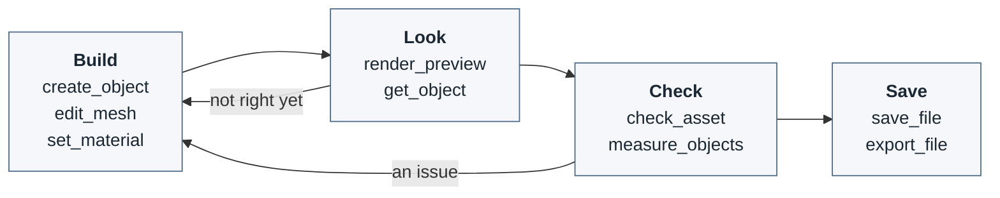
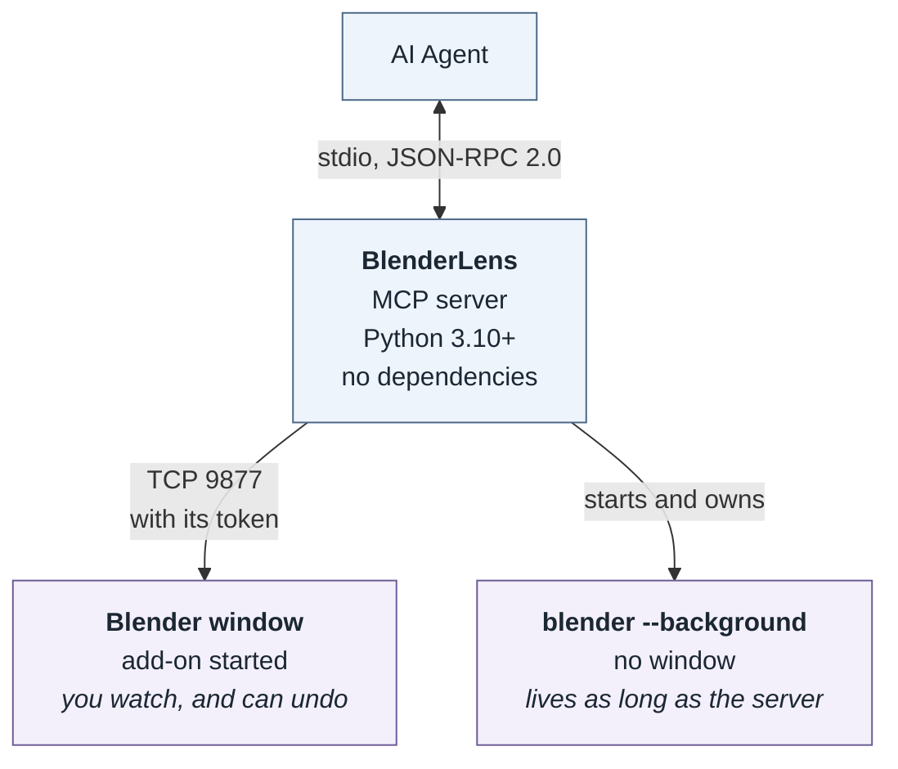

# BlenderLens

[](https://github.com/pzalutski-pixel/blenderlens-mcp/releases)
[](https://www.npmjs.com/package/blenderlens-mcp)
[](https://pypi.org/project/blenderlens-mcp/)
[](https://github.com/pzalutski-pixel/blenderlens-mcp/blob/main/LICENSE)

An MCP server that lets an AI agent model, texture and animate in **Blender**, from a single object to a whole
animated scene. You can watch the agent work in your own Blender window and undo anything it does, or let it work in
a background Blender with no window. The result is an ordinary `.blend` file, or an export in the format you need.

<p align="center">
  
</p>
<p align="center"><i>A short animated scene that an AI agent made in Blender through BlenderLens, shown at double
speed.</i></p>

## What it can do

Once the server is connected, you describe what you want and the agent builds it in Blender. With BlenderLens it can:

- **Model**: start from primitives, tubes along a path, lathed profiles, 3D text or raw vertices, then extrude,
  inset, bevel, bisect, solidify and subdivide, or add any Blender modifier.
- **Texture**: PBR materials with emission and transparency, vertex colours, UV unwrapping, and baked colour,
  ambient occlusion, normal and lighting textures.
- **Animate**: key movement, rotation, scale and shape keys into named clips.
- **Assemble scenes**: place, parent, duplicate and group objects, and drop them until they rest on what is below.
- **See its work**: render previews from any angle, or a sheet of several views, in shaded, clay or wireframe style.
- **Check**: measure parts, find ones that pass through each other, and catch broken geometry before you do.
- **Deliver**: save the `.blend`, or export glTF, FBX, OBJ, STL, PLY or USD; import existing models; run your own
  build scripts.

## Built for AI agents

An agent can already drive Blender by writing Python, but it works blind: it cannot see the result, guesses at
geometry it cannot inspect, and finds out what went wrong only when you open the file. BlenderLens gives it the
feedback a person modelling in Blender gets.

| Agent writing raw Blender Python | Agent with BlenderLens |
|---|---|
| Cannot see what it built | Renders previews from any angle, or a sheet of several views, and looks at them |
| Writes `bmesh` code and guesses which faces to edit | Extrudes, bevels and insets faces picked by the way they face, and gets back the faces it made |
| Cannot tell whether parts touch or pass through each other | Measures distances and overlaps, and drops objects until they rest on what is below |
| Leaves broken geometry, unapplied scale or a misplaced origin for you to find | Finds them with `check_asset`, each with the faces concerned |
| Gets `{'FINISHED'}` from the exporter and nothing more | Reads every export back from disk and reports what the file holds |
| Makes changes you cannot easily take back | Makes every change one undo step |

## Two ways to run

- **In your Blender window.** Install the BlenderLens add-on and press **Start**, and the agent works in the
  Blender you have open. You see each change as it happens, can step in at any point, and can press Ctrl+Z to undo
  any call.
- **In the background.** With no add-on, the server starts `blender --background` itself on the first call that
  needs it, and keeps it until the server exits. Nothing to set up in Blender.

By default the server uses your window when the add-on is started, and a background Blender otherwise.

## Requirements

| | Needed for |
|---|---|
| **Blender 4.2 LTS or later** (tested on 4.2 and 5.0) | everything; found through `BLENDER_BIN`, `PATH`, or the usual install folders |
| **Python 3.10+**, or **Node.js 18+** for `npx` | running this server, which has no dependencies |
| The BlenderLens add-on in Blender | only to work in a Blender window |

No GPU is needed: previews and bakes render with Cycles on the CPU.

## Install

**npx** (recommended). The package bundles the server, and needs Python 3.10 or later on `PATH`.

```json
{
  "mcpServers": {
    "blenderlens": {
      "command": "npx",
      "args": ["-y", "blenderlens-mcp"],
      "env": { "BLENDER_BIN": "C:\\Program Files\\Blender Foundation\\Blender 5.0\\blender.exe" }
    }
  }
}
```

**pip**

```bash
pip install blenderlens-mcp
```

```json
{
  "mcpServers": {
    "blenderlens": { "command": "blenderlens-mcp", "env": { "BLENDER_BIN": "/path/to/blender" } }
  }
}
```

In Claude Code this goes in a project's `.mcp.json`. That is all background mode needs.

### The Blender add-on

To work in a Blender window, install the add-on:

```bash
blenderlens-mcp install-addon       # or: npx -y blenderlens-mcp install-addon; --blender PATH picks the Blender
```

Then, in the 3D viewport, press **N**, open the **BlenderLens** tab and press **Start**. The add-on listens on this
machine only, and serves only a server that holds its token, which it writes to a file the server reads. The add-on
is also attached as a zip to each GitHub release.

## How the agent works

The tools are built around one cycle:



1. **Build.** `create_object` makes a part, `edit_mesh` shapes it, `set_material` colours it, `animate_object`
   moves it, and `join_objects` and `set_parent` assemble parts. An existing build script runs as it is with
   `run_script`.
2. **Look.** `render_preview` renders the part, or a sheet of several angles, as a PNG the agent looks at.
   `get_object` gives exact sizes and counts.
3. **Check.** `check_asset` finds broken geometry, unapplied scale, a misplaced origin, UV and texture problems,
   and parts passing through each other. `measure_objects` says what touches what.
4. **Save.** `save_file` keeps the `.blend`; `export_file` and `export_glb` write other formats and read the file
   back.

## Tools

Units are metres, rotations degrees, and Z is up. Face indices are the ones `get_mesh` lists, and change after any
edit that adds or removes faces.

### Session

| Tool | Description |
|------|-------------|
| `get_status` | Which Blender the server is using and what it is busy with, without starting one. Start here if anything behaves oddly. |
| `open_session` | Connect to the Blender window running the add-on, or start a background Blender, optionally opening a `.blend`. |
| `close_session` | Disconnect. A background Blender exits; a window stays open. Refused while there are unsaved changes, unless `discard`. |

### Inspecting

| Tool | Description |
|------|-------------|
| `get_scene` | Every object with its type, parent, location, dimensions, counts, materials and modifiers. |
| `get_object` | One object in full: transform, bounds, counts before and after modifiers, and every modifier setting. |
| `get_mesh` | An object's faces with index, centre, normal, the side they face and material: the indices other tools take. |
| `list_materials` | Every material's values and the objects using it. |

### Building

| Tool | Description |
|------|-------------|
| `create_object` | A primitive, a tube along a path, a lathed profile, 3D text, or an empty. Sizes go into the mesh, so scale stays 1. |
| `create_mesh` | A mesh from vertices and faces, for shapes no primitive gives. |
| `edit_mesh` | Extrude, inset, bevel, bisect, solidify, subdivide and more, on faces picked by index or by the way they face. |
| `add_modifier` | Add any Blender modifier, with settings by Blender's own names. |
| `set_modifier` | Change a modifier's settings, place in the stack, or visibility. |
| `apply_modifier` | Make a modifier's result part of the mesh. |
| `remove_modifier` | Remove a modifier without applying it. |
| `set_material` | Create or update a PBR material, with emission, transparency, culling and images, on an object or picked faces. |
| `set_vertex_color` | Paint faces into a color attribute. |
| `unwrap_uv` | Unwrap into a UV map, and report islands, overlaps and texel density. |
| `bake_texture` | Bake colour, ambient occlusion, normals, emission or full lighting into a PNG with Cycles, and wire it into the material. |
| `join_objects` | Join meshes into one part, each piece keeping its materials. |
| `animate_object` | Key transforms and shape keys into a named clip. |
| `create_collision` | A box, convex or decimated collision proxy for a game engine's physics. |

### Arranging

| Tool | Description |
|------|-------------|
| `set_transform` | Location, rotation, scale or dimensions. With `drop`, the object falls until it rests on what is below. |
| `apply_transform` | Apply rotation and scale to the mesh, or move the origin, for example to the bottom centre. |
| `set_parent` | Parent or unparent, keeping the world position. |
| `set_collection` | Move objects into a collection. |
| `set_object` | Rename, hide, or set custom properties. |
| `duplicate_object` | Copy an object with its modifiers, materials and children. |
| `delete_object` | Delete objects. |

### Checking and seeing

| Tool | Description |
|------|-------------|
| `check_asset` | Check objects as they will export, optionally against a triangle `budget` and project `rules`. Returns `passed` and each issue with its faces. Changes nothing. |
| `measure_objects` | Distances between parts, whether they touch, overlap or sit inside each other, or a ray cast into the scene. |
| `render_preview` | A framed PNG from a named view or any angle, or several views in one image; shaded, clay, wireframe or per-part colour styles; surrounding objects shown for context, objects hidden from the camera for cutaways, and orthographic views of a fixed width. The scene is left as it was. |

### Files

| Tool | Description |
|------|-------------|
| `save_file` | Save the `.blend`, or a checkpoint copy. |
| `open_file` | Open a `.blend`. |
| `create_file` | Start a new, empty file. |
| `import_file` | Import a glTF, OBJ, FBX, STL or PLY file, or append objects from a `.blend`. |
| `export_file` | Write FBX, OBJ, STL, PLY or USD, and read it back. |
| `export_glb` | Write a `.glb` (binary glTF), read it back, and warn about what Godot or three.js will make of it (see below). |

### Python and undo

| Tool | Description |
|------|-------------|
| `run_python` | Python inside Blender, for anything no tool covers. |
| `run_script` | Run a build script file, with its helper modules importable. |
| `undo_change` | Step back through the calls that changed the scene, one undo step each. |

## Exporting glTF

`export_glb` writes a `.glb`, then opens the written file and reports what it actually holds: the node tree,
triangle counts, materials, and estimates of draw calls and texture memory. It warns about what went missing on the
way, such as objects that are not in the file, a metaball written with no mesh, shape keys dropped by applied
modifiers, textures without the UVs they need, and normal maps without tangents.

Its `target` says which engine will load the file, and so which warnings come back: `godot`, `threejs`, or
`generic` (the default), which gives both:

- **Godot**: names it reads as import hints (`Rock_col` gets a collision body), animations it will loop because of
  their names, nodes it will rename, extensions it cannot load, and vertex colours that Godot 4.7.0 to 4.7.2 ignore
  on a mesh's first primitive. Draco compression is refused, since Godot cannot import it.
- **three.js**: extensions `GLTFLoader` cannot load, or loads only with a decoder the app must set up. Collision
  proxies made by `create_collision` are left out, since three.js would draw them.

## Project rules

When a set of models must follow the same conventions, `check_asset` can hold each one to a triangle budget and to
your own rules, given inline or as a `rules_file`. The rules are a JSON object, and each key is optional:

| Key | Fails when |
|---|---|
| required | a named object, or a `"Parent/Child"` path, is missing |
| single_root | the asset does not have exactly one root object |
| retired | an object or material has a name the project no longer uses |
| palette, palette_only | a material's colour or values differ from the palette, or a material is not in it |
| extras | a custom property is missing or of the wrong type |
| size | an object measures outside its range, in metres |
| origin_at_base | an origin is not at the bottom of the object |
| budget | the asset, or a named part, has too many triangles |
| apart | two parts that must not touch pass through each other |

A name may also be a pattern, `"re:<regular expression>"`. [examples/rules.json](https://github.com/pzalutski-pixel/blenderlens-mcp/blob/main/examples/rules.json)
is a complete rule set, and [examples/build_lantern.py](https://github.com/pzalutski-pixel/blenderlens-mcp/blob/main/examples/build_lantern.py)
builds, checks and exports a prop through the server from start to finish.

The same checks run without an agent, for example in a build pipeline. A `.glb` is read with no Blender; a `.blend`
is opened in a background Blender. `--target` adds that engine's warnings, and `--json` prints the full result. The
command exits 0 when the model passes, 1 when it fails, and 2 when it could not be checked.

```bash
blenderlens-mcp check lantern.glb --budget 2000 --rules rules.json
```

## Errors

When a tool refuses a call, it changes nothing and returns `error` (what went wrong), `exit` (a fixed number for
each kind), `kind` and `hint` (what to do about it).

| Exit | Kind | Meaning |
|---|---|---|
| 1 | `blender_error` | Blender raised an error while running the call |
| 2 | `not_found` | An object, material, file or geometry the call needs does not exist |
| 3 | `bad_argument` | A parameter has a value Blender cannot use |
| 4 | `python_error` | Code run by `run_python` or `run_script` raised an exception |
| 5 | `unsaved_changes` | The open file has unsaved changes; save first, or pass `discard` |
| 6 | `blender_missing` | No Blender executable was found |
| 7 | `not_connected` | No BlenderLens add-on responded |
| 8 | `connection_lost` | Blender exited or crashed, or the add-on was stopped, during the call |
| 9 | `start_failed` | The background Blender did not start |
| 10 | `version_mismatch` | The add-on speaks another protocol version; reinstall it |
| 11 | `token_mismatch` | The add-on refused the server's token |
| 12 | `busy` | Blender is still working on an earlier call |
| 13 | `not_allowed` | Python is turned off, or a path is outside `BLENDERLENS_ALLOWED_DIRS` |
| 70 | `internal_error` | A fault in BlenderLens itself |
| 124 | `deadline` | Blender did not respond in time, and may still be working |

## Limitations

- **Python is unrestricted.** `run_python` and `run_script` can do anything Python can inside Blender, including
  quitting it. Set `BLENDERLENS_ALLOW_PYTHON=0`, or turn off **Allow Python from the agent** in the add-on, where
  that matters.
- **`drop` finds supports at vertices.** When the only contact would be edge against edge, such as one bar lying
  across another, that support is missed and the object drops past it.
- **A Principled BSDF inside a node group is invisible to BlenderLens**, so it will not change that material's
  values.
- **In a Blender window, a preview marks the file as changed**, because Blender does so whenever the render engine
  is set, even back to the same one.
- **Blender's glTF exporter writes a metaball as an empty node.** `check_asset` reports metaballs as errors, and
  `export_glb` warns about them.

## Architecture



Both ways run the same command code, on Blender's main thread; mesh work goes through `bmesh`, so it behaves the
same with or without a window. Each call that changes the scene is one undo step. The MCP protocol and the link to
Blender are built on the Python standard library, so the package has **no runtime dependencies**.
[docs/architecture.md](https://github.com/pzalutski-pixel/blenderlens-mcp/blob/main/docs/architecture.md) maps the
modules, and [docs/decisions/](https://github.com/pzalutski-pixel/blenderlens-mcp/tree/main/docs/decisions) records
why each part is built as it is.

## Configuration

| Variable | Default | Description |
|---|---|---|
| `BLENDER_BIN` | auto | Blender executable, for background sessions, `check` and `install-addon` |
| `BLENDERLENS_MODE` | `auto` | `auto` (the window when its add-on is started, otherwise background), `live` (the window only) or `background` |
| `BLENDERLENS_HOST` | `127.0.0.1` | Where the server connects to the add-on: `localhost` or a loopback IPv4 address |
| `BLENDERLENS_PORT` | `9877` | The add-on's port, as set in its preferences |
| `BLENDERLENS_TOKEN` | from the add-on's file | Overrides the token the add-on writes for the server |
| `BLENDERLENS_TIMEOUT` | `120` | Seconds to wait for one call; `render_preview`, `bake_texture`, `run_python` and `run_script` also take `timeout` |
| `BLENDERLENS_START_TIMEOUT` | `90` | Seconds to wait for a background Blender to start |
| `BLENDERLENS_RENDER_DIR` | a temp folder | Where previews go when given no `path`; in the default folder they are kept 7 days |
| `BLENDERLENS_ALLOW_PYTHON` | `1` | `0` removes `run_python` and `run_script` |
| `BLENDERLENS_ALLOWED_DIRS` | not set | Folders every path given to a tool must be inside; `;` separates them on Windows, `:` elsewhere |
| `BLENDERLENS_RUNTIME_DIR` | per user | Where the add-on's token file and recovery copies of unsaved background work are kept |

## License

Apache License 2.0 — see [LICENSE](https://github.com/pzalutski-pixel/blenderlens-mcp/blob/main/LICENSE) and
[NOTICE](https://github.com/pzalutski-pixel/blenderlens-mcp/blob/main/NOTICE). BlenderLens is not affiliated with
or endorsed by the Blender Foundation.

<!-- mcp-name: io.github.pzalutski-pixel/blenderlens -->
