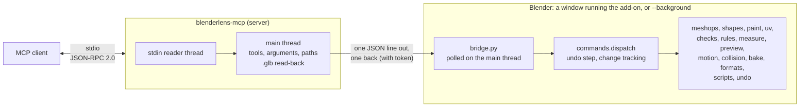

# Architecture

BlenderLens consists of two programs that talk to each other over a simple line-based protocol:

- **the MCP server**, written in Python 3.10 or later with no dependencies, which the agent's MCP client starts;
- **the add-on**, which runs inside Blender.

This page describes where things are in the code. The design records in [`decisions/`](decisions/) explain why
each part works the way it does.

## The server (`src/blenderlens_mcp/`)

| Module | Contents |
|---|---|
| `server.py` | The JSON-RPC loop over stdio, supporting both the session-based protocol revisions (`initialize`) and the stateless 2026-07-28 revision. A separate thread reads stdin, replies to `ping` and handles cancellations, while the main thread serves one request at a time. It also sends progress notifications, returns links to preview images, and reads exported `.glb` files back. |
| `tools.py` | The tool table: each tool's name, title, description, input schema and annotations. |
| `arguments.py` | Checks tool arguments against the tool's input schema before anything is sent to Blender. |
| `session.py` | Finds the Blender executable, connects to the add-on in a Blender window (live mode), or starts and manages a background Blender. It tracks the one request that may still be running in Blender, so that a Blender that is busy is not mistaken for one that has gone away. It also saves recovery copies of unsaved work and cleans up temporary files. |
| `glb.py` | Reads a `.glb` file and describes its contents, with warnings for a target engine. Used by `export_glb` and the `check` command. |
| `cli.py` | The `blenderlens-mcp` command: serving MCP, `check`, `build-addon` and `install-addon`. |
| `errors.py` | The kinds of refusal and their exit codes. |
| `resources.py` | The guide resource for agents. |
| `background.py` | The script a background Blender runs: it loads the add-on's modules under a separate name and serves commands until the server's pipe closes. |

## The add-on (`src/blenderlens_mcp/addon/`)

The same modules serve live mode, in a Blender window running the add-on, and background mode. Everything runs on
Blender's main thread, and mesh editing goes through `bmesh`.

| Module | Contents |
|---|---|
| `__init__.py` | Registration, preferences, the sidebar panel, the access token and connection file, and the timer that polls the socket. |
| `bridge.py` | The local socket. A client must send the token in its first line, or the connection is closed. The number of connections is limited, and each request gets one response. |
| `runtime.py` | Locates the runtime folder and reads and writes the connection file. It does not use `bpy`, so the server uses it too. |
| `commands.py` | `COMMANDS` and `dispatch`. `dispatch` runs each command and tracks whether it changed the file. A command that may have changed it becomes one undo step, except `undo_change` itself; a refusal that put everything back adds no step, and `hello` and `save_copy` run outside this tracking. The module also holds the commands for reading the scene, modifiers, materials, transforms, files and export. |
| `common.py` | `CommandError`, `Rollback`, argument readers (`number`, `boolean`, `triple` and others), lookups by name, and helpers for reporting values. |
| `meshops.py` | `create_object`, `create_mesh`, `get_mesh`, and the operations of `edit_mesh`. |
| `shapes.py` | The tubes, lathed shapes and text that `create_object` makes. |
| `paint.py` | `set_vertex_color`, and how materials are connected to a color attribute. |
| `uv.py` | `unwrap_uv`. |
| `checks.py` | `check_asset`. |
| `rules.py` | Project rules: checking that a rule set is valid, and applying it. The server's `check` command uses it too. |
| `measure.py` | `measure_objects`, the `drop` of `set_transform`, and moving an object's origin. |
| `preview.py` | `render_preview`: framing, sheets of several views and display styles, with the scene restored afterwards. |
| `motion.py` | Animation clips (`animate_object`). |
| `collision.py` | Collision shapes (`create_collision`). |
| `bake.py` | Texture baking (`bake_texture`). |
| `formats.py` | Export to formats other than glTF (`export_file`). |
| `scripts.py` | `run_python` and `run_script`. |
| `undo.py` | `undo_change`, the list of undo steps BlenderLens made, and detecting edits made outside BlenderLens, such as the user's own edits in live mode. |

## A tool call from start to finish

1. **The client sends `tools/call`.** The reader thread puts it in a queue.
2. **The server checks the call.** The main thread checks the arguments against the tool's schema and, if
   `BLENDERLENS_ALLOWED_DIRS` is set, checks every path.
3. **The server connects to Blender if needed.** If it is not connected, it connects according to
   `BLENDERLENS_MODE`.
4. **The command is sent to Blender** as one line of JSON. The server waits for the response, and at each
   quarter-second poll it sends any progress notification that is due and checks for cancellation.
5. **Blender runs the command.** The bridge reads the line on Blender's main thread, and `dispatch` runs the
   command:
   - every parameter is checked before anything changes;
   - if Blender refuses an operation partway through, what was already changed is rolled back;
   - a command that changes the scene becomes one undo step, in live and background mode alike.
6. **The result comes back** as one line of JSON, with NaN and infinite numbers written as strings. For an export,
   the server reads the written file back from its path and adds warnings for the target engine.
7. **The client receives a tool result.** A refusal has `isError` set, with `error`, `exit`, `kind` and `hint`.

## Tests

- **No Blender needed:** `pytest -m "not integration and not live"`. These tests cover the protocol, the tool
  table, project rules, the `.glb` reader, the release scripts, and the npm launcher (which needs Node.js).
- **Integration:** `pytest -m integration` drives the real server over stdio against a real background Blender,
  and checks what Blender holds and what the written files contain.
- **Live:** `BLENDERLENS_TEST_LIVE=1 pytest -m live` opens Blender windows with the add-on installed in a
  temporary user folder. These tests cover what only live mode has: the token and the connection file, the panel
  and its timer, the user's own edits between calls, and the user's own mode and selection. They also run each
  group of tools once in a real window.
- **CI** runs the unit tests on Linux, Windows and macOS with Python 3.10 to 3.13, and the integration tests
  against Blender 4.2 LTS and 5.0 on Linux and Windows, and 5.0 on macOS.
